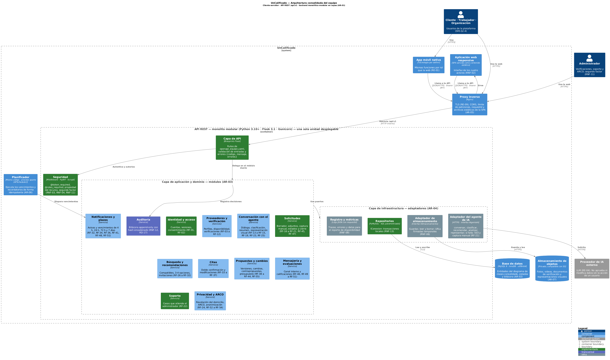
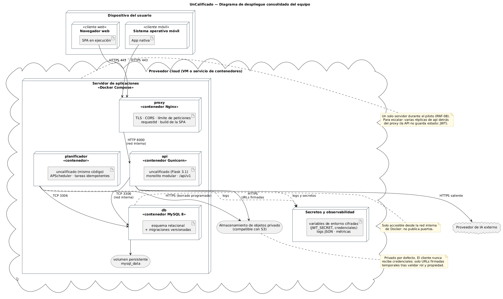

# Arquitectura consolidada del equipo — UnCalificado

**Actividad:** S05_S06_A1 · **Fecha:** 25 de octubre de 2026 · **Estado:** propuesta para validar en la reunión del equipo

**Diagramas definitivos (PlantUML con su imagen):**

| Diagrama | Archivo |
|---|---|
| C4 de contenedores y componentes del backend | `arquitectura_equipo_componentes.puml` / `.png` |
| UML de despliegue | `arquitectura_equipo_despliegue.puml` / `.png` |

**Se relaciona con:**
- `../02_openapi/openapi_equipo.yaml`: la interfaz REST que expone la capa de API;
- `../03_diagrama_clases/diagrama_clases_equipo.puml`: el modelo que persiste la base de datos;
- `../diferencias_diseno.md`: el resumen de aportes y conflictos de los tres artefactos.

## 1. Insumos comparados

| Integrante | Diagrama de componentes | Estilo | Backend | Base de datos | Archivos | Tareas programadas | Otros elementos |
|---|---|---|---|---|---|---|---|
| David | `diagrama_componentes.mmd` (Mermaid, flujo) | Monolito modular en capas (ADR-001) | No especificado; 9 módulos de dominio en el ADR | PostgreSQL | Objetos privados | Worker de notificaciones con cola o tabla de trabajos | Adaptador de IA |
| Israel | `arquitectura_02_contenedores` (C4) y `arquitectura_04_componentes_uml` (UML con interfaces) | Cliente-servidor y monolito modular en capas (ADR-001) | Flask 3.1, **implementado**; blueprints, servicios e interfaces (`IAgenteIA`, `IAlmacenamiento`, `IConexion`) | MySQL 8, **implementado** | «Por definir» | Planificador (previsto) | Middleware de seguridad, validación y errores como componentes |
| Jesús | `diagrama_componentes.puml` (componentes) | **Serverless:** API Gateway con 6 funciones Lambda por capacidad | Funciones Lambda | PostgreSQL administrado | Object storage con URLs temporales | Scheduler | Frontend en CDN, API Gateway con límite de peticiones, autenticación con MFA, gestor de secretos y observabilidad |
| Norman | `diagrama_componentes.puml` (C4) | Cliente-servidor y monolito modular en capas (ADR-001) | Node.js + Express + TypeScript («decisión de implementación»); 14 módulos | Abstracta | Abstracto | Módulo «Notificaciones y plazos» | Capa de infraestructura con adaptadores; módulo de auditoría |

## 2. Resultado de la comparación

**Consenso entre los cuatro:**
- web responsive y app nativa como clientes de una sola API REST sobre HTTPS con JWT (RNF-02, RE-01, RE-09);
- base de datos relacional;
- proveedor de IA externo detrás de un adaptador, con captura manual si no está disponible (RF-21, RE-04);
- almacenamiento de archivos separado de la base de datos (RNF-06);
- un componente para los vencimientos y recordatorios del SRS.

**Conflictos:**
1. **Estilo:** David, Israel y Norman usan un monolito modular; Jesús, serverless con funciones Lambda.
2. **Tecnología del backend:** Israel usa Flask; Norman, Node.js y Express; David y Jesús no la fijan.
3. **Motor de base de datos:** Israel usa MySQL 8; David y Jesús, PostgreSQL; Norman lo deja abstracto.
4. **Forma de ejecutar las tareas programadas:** David usa un worker; Israel y Jesús, un planificador aparte; Norman, un módulo dentro de la API.
5. **Granularidad de los módulos:** David tiene 9 módulos, Jesús 6 funciones, Norman 14 módulos e Israel 6 blueprints.
6. **Dónde se aplican las políticas de borde:** Jesús usa API Gateway; los demás no las modelan o las dejan en la aplicación.

**Gaps** (elementos que solo propuso un integrante):
- de Jesús: frontend como contenido estático, límite de peticiones, secretos y observabilidad, URLs temporales;
- de Israel: interfaces explícitas entre capas y componentes de seguridad y errores;
- de Norman: módulo de auditoría y capa de infraestructura como frontera;
- de David: worker con reintentos y registro de entrega.

## 3. Decisiones de arquitectura

| ID | Conflicto | Decisión | Justificación |
|---|---|---|---|
| **AR-01** | Estilo arquitectónico | **Cliente-servidor con API REST sin estado y backend monolítico modular en capas**: una sola unidad desplegable. Se descarta la descomposición serverless de Jesús. | Lo proponen tres de cuatro y los tres ADR coinciden. Muchas operaciones del SRS cambian varias entidades a la vez; por ejemplo, confirmar una cita bloquea una franja, cambia el estado del proyecto, revela el domicilio y escribe en la bitácora. Con funciones separadas, esas operaciones exigirían coordinación distribuida para cumplir RNF-12 y RNF-13. Para un desarrollador por rol, un despliegue y una depuración local cuestan menos. Las funciones por capacidad de Jesús se conservan como **módulos internos** (AR-03), y su separación por capacidad deja abierta la extracción futura. |
| **AR-02** | Motor de base de datos | **MySQL 8 (InnoDB, utf8mb4).** | Ya existe `schema.sql`, con cinco tablas en uso, y el backend funciona con PyMySQL (costo de cambio). MySQL 8 cubre lo que exige el modelo consolidado: transacciones, llaves foráneas, `CHECK`, `ENUM` y JSON. David y Jesús proponían PostgreSQL por madurez y JSONB, pero ningún requerimiento depende de una función exclusiva de PostgreSQL. El diagrama de clases y las reglas de transformación (§7 de `analisis_diagrama_clases.md`) son portables: si el equipo decide cambiar de motor, el impacto queda en la capa de repositorios. **Se debe validar en la reunión**, porque contradice a dos integrantes. |
| **AR-03** | Granularidad de los módulos | **12 módulos de aplicación y dominio** alineados con los grupos de `openapi_equipo.yaml`: Identidad y acceso; Proveedores y verificación; Conversación con el agente; Solicitudes; Búsqueda y recomendaciones; Citas; Propuestas y cambios; Mensajería y evaluaciones; Soporte; Privacidad y ARCO; Notificaciones y plazos; Auditoría. | Base: los 14 módulos de Norman. Se fusionan «Seguimiento y cierre» con Solicitudes, porque es la máquina de estados de la misma entidad (OA-16, OA-G3), y «Mensajería» con «Evaluaciones», porque ambas pertenecen a la etapa de seguimiento y tienen pocas reglas. Las 6 funciones de Jesús y los 9 módulos de David caben sin pérdida en esta división (§4). Cada módulo es dueño de sus tablas, y los demás módulos le piden los datos por su servicio, no por SQL directo. |
| **AR-04** | Fronteras internas | **Tres capas:** API (blueprints, validación, errores) → aplicación y dominio (servicios por módulo) → infraestructura (repositorios, adaptador de IA, adaptador de almacenamiento, registro y métricas). Las dependencias hacia afuera pasan por **interfaces** (`IConexion`, `IAgenteIA`, `IAlmacenamiento`). | Combina la capa de infraestructura de Norman con las interfaces explícitas de Israel. Con inversión de dependencias, el proveedor de IA y el almacén se pueden cambiar o simular en pruebas (DoD-03) sin tocar los servicios. Seguridad y Auditoría son transversales: Seguridad la invocan las rutas y Auditoría, los módulos que registran decisiones. |
| **AR-05** | Políticas de borde | **Proxy inverso Nginx** delante de la API: TLS (RE-09), CORS, límite de peticiones, `requestId` y entrega de la SPA compilada. La autenticación JWT y la autorización por rol y propiedad **se quedan en la aplicación**. | Adopta las capacidades del API Gateway de Jesús sin depender de un proveedor cloud concreto. Autorizar por propiedad del recurso (RNF-04) requiere datos del dominio, así que solo la aplicación puede hacerlo: el borde solo filtra. Servir la SPA desde el proxy cubre lo que Jesús y Norman resolvían con un servidor estático o una CDN; puede moverse a una CDN más adelante sin cambiar la arquitectura. |
| **AR-06** | Tareas programadas | **Planificador como proceso aparte con el mismo código** (contenedor `planificador`, APScheduler). Invoca al módulo «Notificaciones y plazos», y cada tarea es **idempotente**: busca los registros vencidos y los marca en una transacción. | Une las cuatro propuestas: el código vive en el módulo de Norman, corre en un proceso aparte como el worker de David y el planificador de Israel, y es idempotente como pide Jesús. Separar el proceso evita que un reinicio o el escalamiento de la API dupliquen o pierdan vencimientos (RF-32, RF-34, RF-41, RF-48, RF-51, RF-52-AC-4). No es un microservicio, porque comparte el código y la base de datos. |
| **AR-07** | Almacenamiento de archivos | **Almacenamiento de objetos privado compatible con S3**, accedido solo por el adaptador. Los clientes reciben **URLs firmadas temporales** después de que se valida el rol y la propiedad. | Consenso de David, Jesús y Norman; las URLs temporales las aportó Jesús. Cumple RNF-05 y RNF-06 sin guardar binarios en MySQL. El adaptador permite usar MinIO o un sistema de archivos local en desarrollo. |
| **AR-08** | Tecnología del backend | **Python 3.10+, Flask 3.1 y Gunicorn**, lo que ya está implementado. | Norman propuso Node.js + Express como decisión de implementación personal. El Sprint 1 ya tiene autenticación, solicitudes y soporte en Flask, con pruebas. Cambiar de lenguaje no aporta ningún atributo de calidad que el SRS exija y tiraría trabajo terminado. La arquitectura se describe por capas y módulos, así que sería válida con cualquiera de las dos tecnologías. |
| **AR-09** | Observabilidad y secretos | **Logs JSON con `requestId`**, métricas básicas y **secretos en variables de entorno cifradas** (`JWT_SECRET` y credenciales). | Gap adoptado de Jesús. Hace falta para diagnosticar fallas en el piloto y para el reporte mensual de disponibilidad (RNF-09-AC-1, `GET /reportes-disponibilidad`, OA-27). El monitoreo externo consulta `GET /health`. |

## 4. Correspondencia entre los módulos individuales y los del equipo

| Módulo del equipo | David | Jesús (función Lambda) | Norman | Israel (blueprint y servicio) | Grupo de la API |
|---|---|---|---|---|---|
| Identidad y acceso | Identidad y consentimiento | Identidad y usuarios | Identidad y acceso | Cuentas `/auth` · `usuarios_service` | Cuentas |
| Proveedores y verificación | Perfiles y verificación | Proveedores | Proveedores y verificación | (previsto) | Proveedores, Verificaciones |
| Conversación con el agente | Proyectos y conversación | Solicitudes + IA | Conversación / Agente de IA | Conversaciones (previsto) | Conversaciones |
| Solicitudes | Proyectos y conversación; seguimiento | Solicitudes + IA | Solicitudes; Seguimiento y cierre | Solicitudes · `solicitudes_service` | Solicitudes |
| Búsqueda y recomendaciones | Búsqueda y recomendaciones | Solicitudes + IA | Búsqueda y recomendaciones | (previsto) | Búsqueda |
| Citas | Citas | Contratación | Citas | Contratación (previsto) | Citas |
| Propuestas y cambios | Propuestas y cambios | Contratación | Propuestas y cambios | Contratación (previsto) | Propuestas, Cambios |
| Mensajería y evaluaciones | Seguimiento y mensajería; evaluaciones | Comunicación y evaluaciones | Mensajería; Evaluaciones | (previsto) | Mensajes, Evaluaciones |
| Soporte | — | — | Soporte | Soporte `/casos-soporte` · `casos_service` | Soporte |
| Privacidad y ARCO | Privacidad y auditoría | Privacidad y administración | Privacidad y ARCO | (previsto) | Privacidad |
| Notificaciones y plazos | Worker de notificaciones | Scheduler | Notificaciones y plazos | Planificador (previsto) | Notificaciones |
| Auditoría | Privacidad y auditoría | (dentro de Contratación) | Auditoría | — | (`registros-bitacora`) |

## 5. Vista de componentes

Lectura del diagrama:

- **Verde:** ya implementado en el Sprint 1. Incluye la capa de API, la seguridad, los repositorios y los módulos Identidad, Solicitudes y Soporte.
- **Azul claro:** previsto.
- **Morado:** transversal.
- **Gris:** adaptador de infraestructura.

Flujo de una petición:

1. El cliente llama a `/api/v1` por HTTPS.
2. El proxy aplica TLS y el límite de peticiones, y reenvía la petición.
3. La capa de API valida la entrada y llama a Seguridad, que verifica el JWT, el rol y la propiedad del recurso.
4. El módulo dueño ejecuta la regla de negocio en una transacción y registra en Auditoría si hay una decisión.
5. El módulo usa los adaptadores para la base de datos, los archivos o la IA.

### Interfaces entre contenedores

| Origen → destino | Protocolo | Contrato |
|---|---|---|
| Web o app → proxy → API | HTTPS + JSON, Bearer JWT | `openapi_equipo.yaml` v1.0.0 |
| API → base de datos | TCP 3306 en la red interna; SQL parametrizado | Esquema derivado de `diagrama_clases_equipo.puml` |
| API → almacenamiento | HTTPS, API compatible con S3 | `IAlmacenamiento` (guardar, leer, borrar, URL firmada) |
| API → proveedor de IA | HTTPS saliente | `IAgenteIA` (conversar, clasificar, recomendar, analizar, representar) |
| Planificador → base de datos | TCP 3306 | Tareas idempotentes del módulo Notificaciones y plazos |

## 6. Vista de despliegue

El piloto corre en **un servidor con Docker Compose**, que levanta cuatro contenedores: `proxy`, `api`, `planificador` y `db`, con un volumen persistente. Fuera del servidor quedan el almacenamiento de objetos y el gestor de secretos.

- La base de datos no publica puertos fuera de la red interna.
- La API no guarda estado (JWT), así que escalar consiste en agregar réplicas de `api` detrás del proxy, sin cambiar la arquitectura.

Esto toma el contenedor único de Norman y David, los contenedores de Israel, y el borde, los secretos y la observabilidad de Jesús.

## 7. Atributos de calidad y cómo los atiende la arquitectura

| Atributo (SRS) | Mecanismo |
|---|---|
| Seguridad (RNF-03, RNF-04, RNF-05, RNF-11, RE-09) | TLS en el proxy. JWT y roles en el componente Seguridad, y propiedad del recurso verificada en cada módulo. Base de datos aislada. URLs firmadas para los archivos. Segundo factor para el administrador. |
| Integridad y auditoría (RNF-12, RD-17) | Módulo Auditoría con bitácora append-only y hash encadenado; transacciones locales. |
| Continuidad (RNF-13) y disponibilidad (RNF-09) | Volumen persistente, tareas idempotentes, `GET /health` y reporte mensual de disponibilidad. |
| Rendimiento (RNF-08) | Un proceso sin llamadas de red entre módulos; Gunicorn con varios workers; réplicas posibles. |
| Mantenibilidad | Módulos con dueño de datos, capas e interfaces (AR-03, AR-04); un contrato OpenAPI único. |
| Tolerancia a fallas de la IA (RF-21, RE-04) | Adaptador con tiempo límite; si falla, responde 503 con `capturaManualDisponible` y el flujo sigue con la captura manual. |

## 8. Riesgos y condiciones para revisar la arquitectura

- **Monolito que crece sin disciplina.** Mitigación: revisar en code review que ningún módulo lea tablas de otro.
- **Planificador como punto único de falla.** Mitigación: las tareas son idempotentes y pueden volver a correr sin efectos duplicados.
- **Revisión de la decisión AR-01.** Se revisa si un módulo necesita escalar por separado; el primer candidato es la conversación con IA, por su latencia. En ese caso se extrae el módulo detrás del mismo contrato.
- **Revisión de la decisión AR-02.** Se revisa si el equipo adopta PostgreSQL.
